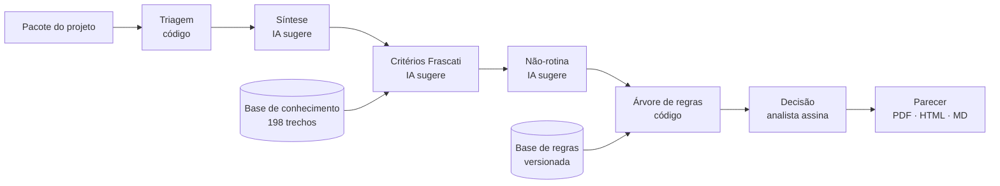

# BNBem · Sistema Inteligente de Apoio à Decisão da Lei do Bem

O BNBem ajuda a equipe de Pesquisa e Inovação (P&D) do Banco do Nordeste a fazer a **análise preliminar de enquadramento na Lei do Bem** com segurança técnica e um registro que se sustenta numa fiscalização. A regra que guia o produto é: **a IA sugere, o analista decide e o parecer registra o porquê.**

> 🥈 **2º lugar entre 27 equipes no Hackathon Siará Tech Summit 2026** (Fortaleza, 7 a 9 de outubro de 2026). Desafio proposto pelo Banco do Nordeste por meio do Hubine, com realização do Sebrae/CE e organização da Voa Inovação.

|                                    |                                                                                  |
| ---------------------------------- | -------------------------------------------------------------------------------- |
| **Protótipo e código**     | Acesso restrito, sob solicitação (veja [Acesso ao código](#acesso-ao-código)) |
| **Demonstração em vídeo** | Disponível sob solicitação                                                    |
| **Pitch apresentado**        | [PDF](docs/pitch.pdf)                                                             |
| **Exemplos de parecer**      | Disponíveis sob solicitação                                                   |
| **Equipe**                   | TATU (veja [Equipe TATU](#equipe-tatu))                                           |

---

## O problema

Hoje, cada projeto de inovação do BNB passa por uma consultoria externa que diz se ele é pesquisa ou rotina. As regras existem, mas estão espalhadas por cinco documentos longos (Lei, Decreto, Instrução Normativa, Portaria e Guia do MCTI). Não há um caminho que o analista consiga seguir sozinho.

- **Custo:** o contrato de consultoria para Lei do Bem e ativo intangível soma R$ 1,77 milhão nos anos-base 2022 a 2025. Só a Lei do Bem custou R$ 369 mil no ano-base 2025.
- **Prazo:** o ciclo do ano-base 2025 levou cerca de 10 meses, do diagnóstico ao dossiê final.
- **Risco:** o MCTI pode glosar o incentivo anos depois, e o prazo de contestação é de 30 dias (Portaria MCTI 9.563/2025, art. 12). Se o porquê da decisão não foi registrado, quem precisar defendê-la pode nem ter participado da análise.

A pergunta do desafio:

> Como podemos **estruturar o conhecimento** sobre elegibilidade da Lei do Bem em um **sistema de apoio à decisão** que permita à **equipe interna de P&D do BNB** conduzir **análises preliminares de enquadramento** com **segurança técnica e rastreabilidade defensável**, de modo a **reduzir a dependência de consultoria externa**, considerando a **complexidade normativa** relacionada e a **necessidade de padronização** entre múltiplos projetos?

## O que o BNBem faz

O BNBem leva o analista do pacote do projeto até o parecer preliminar em 7 passos. Cada passo deixa claro quem age.

| # | Passo                 | Quem age                      | O que acontece                                                                                                                                             |
| - | --------------------- | ----------------------------- | ---------------------------------------------------------------------------------------------------------------------------------------------------------- |
| 1 | **Projeto**     | Analista                      | Envia os arquivos do pacote do projeto, por arquivo ou por pasta                                                                                           |
| 2 | **Triagem**     | Código, sem IA               | Confere se o pacote está completo, valida os IDs, recalcula as medições e marca falas da entrevista para confrontar com os registros                    |
| 3 | **Síntese**    | IA → analista                | A IA resume o problema, o estado anterior e o núcleo alegado; o analista confirma                                                                         |
| 4 | **Critérios**  | IA → analista                | A IA responde às 5 perguntas do Manual de Frascati com raciocínio, evidência por ID e regra aplicada; o analista aceita ou corrige, informando o motivo |
| 5 | **Não-rotina** | IA → analista                | Lista sinais de rotina e de incentivabilidade, lacunas e divergências                                                                                     |
| 6 | **Decisão**    | Árvore de regras → analista | Uma árvore determinística recomenda a classe e calcula o índice de robustez; o analista assina                                                          |
| 7 | **Parecer**     | Sistema                       | Gera o parecer sintético (1 página) ou analítico (dossiê), em PDF, HTML ou Markdown                                                                    |

**Classes de saída:** Elegível · Com ressalvas · Não elegível · Evidência insuficiente.

### Módulos além do fluxo

- **Processamento em lote:** recebe uma pasta com vários projetos e faz a triagem de todos. Depois passa cada projeto pela IA, mostrando o andamento, com opção de pausar e retomar. Também calcula o tempo médio por projeto, compara com o gabarito na calibração e exporta ou importa o lote.
- **Painel gerencial:** mostra indicadores, a distribuição por classe, em quais critérios os projetos falham e um ranking por equipe de origem.
- **Assistente "Pergunte ao BNBem":** um chat presente em todas as telas, que conhece a etapa atual, a análise e as normas. Ele foi instruído a não decidir pelo analista e a não inventar fontes.
- **Base de conhecimento:** 198 trechos pesquisáveis da Lei 11.196/2005, do Decreto 5.798/2006, da IN RFB 1.187/2011, da Portaria MCTI 9.563/2025, do Guia Prático 2026, do FAQ do MCTI e da base de regras.
- **Recursos transversais:**
  - linguagem simples ligada por padrão, com "o que fazer aqui" em cada tela;
  - reanálise após nova evidência, com comparação de versões;
  - devolução à área de origem com o pedido de complemento;
  - IA em modo padrão ou criterioso.

## Como funciona por dentro

A principal decisão de arquitetura foi **tirar a classificação da IA**. A IA lê o pacote e sugere o estado de cada critério, sempre com evidência. Quem recomenda a classe é uma árvore de regras determinística. O analista decide nas duas pontas.



A triagem e a árvore são código puro: auditável e igual para todos os projetos. Trocar o modelo de IA (por exemplo, por um modelo privado no ambiente do banco) mexe só nas chamadas de IA. A triagem e a árvore de regras continuam iguais.

| Camada              | Tecnologia                                                                                | Por quê                                                                                    |
| ------------------- | ----------------------------------------------------------------------------------------- | ------------------------------------------------------------------------------------------- |
| Interface e lógica | Aplicação web                                                                           | Nada a instalar; abre pelo navegador                                                        |
| IA                  | Claude (Anthropic), pelo runtime de artefatos do claude.ai, em modo padrão ou criterioso | O Guia do Participante autorizou o uso de LLM externo na massa de dados fictícia do evento |
| Regras              | Base de regras versionada, com a origem de cada item                                      | Se a norma mudar, atualiza-se a base, sem reprogramar                                       |
| Documentos          | [pdf.js](https://mozilla.github.io/pdf.js/) e [pdf-lib](https://pdf-lib.js.org/)            | Ler os PDFs do pacote e gerar o parecer em PDF                                              |
| Visual              | Tokens de cor do BNB e fonte Heebo                                                        | Familiaridade para o analista do banco                                                      |

**Hierarquia normativa aplicada:** Lei > Decreto > IN RFB / Portaria MCTI > Guia Prático MCTI > Manual de Frascati.

### Segurança e dados

- CPF, CNPJ, e-mail, telefone e valores são mascarados antes de qualquer envio à IA.
- Nada fica gravado fora da aba do navegador. O analista exporta e importa as análises.
- A base de regras é versionada, e cada item registra sua origem.

## Acesso ao código

Este repositório é a vitrine pública do projeto. O protótipo, a base de regras, as instruções da IA e a base de conhecimento ficam num **repositório privado**, com acesso restrito à equipe TATU e a pessoas autorizadas do Banco do Nordeste, Hubine e Sebrae, nos termos do edital do hackathon (item 13.4).

Para solicitar acesso: [luisgustavobl10@gmail.com / tatu.hackathon@gmail.com](<https://mail.google.com/mail/?view=cm&fs=1&to=luisgustavobl10@gmail.com,tatu.hackathon@gmail.com&su=Solicitar%20acesso%20ao%20prot%C3%B3tipo&body=Ol%C3%A1!%0A%0AGostaria%20de%20solicitar%20acesso%20ao%20prot%C3%B3tipo.%0A%0AEmpresa%2FInstitui%C3%A7%C3%A3o%3A%20%0ANome%3A%20%0ACargo%2F%C3%81rea%3A%20>)

## Resultados no evento

| Medida                                                   | Resultado                                                                               |
| -------------------------------------------------------- | --------------------------------------------------------------------------------------- |
| Calibração de ponta a ponta (IA + regras)              | 19 de 20 históricos com a mesma classe do gabarito                                     |
| Árvore de regras sozinha, com os estados do gabarito    | 20 de 20                                                                                |
| Tempo de análise da IA por projeto                      | de 47 segundos a 2 minutos                                                              |
| Lote                                                     | dezenas de projetos em até 16 minutos                                                  |
| Análise preliminar completa, com a revisão do analista | de 0,5 h a 2 h por projeto (hoje: 90 projetos em 20 dias pela consultoria)              |
| Testes de validação                                    | 141                                                                                     |
| Casos do evento analisados                               | 20 projetos: 3 Elegível, 6 Com ressalvas, 6 Não elegível e 5 Evidência insuficiente |

Mais detalhes, como as rodadas de teste, a matriz de confusão, a estabilidade e a verificação de alucinação, estão em [`docs/resultados_BNBem.xlsx`](docs/resultados_BNBem.xlsx). A planilha traz só estatísticas agregadas, sem identificar projetos.

Os números vêm da massa de dados **fictícia** do evento, que é confidencial e não faz parte deste repositório (veja [Dados](#dados)).

## Estrutura do repositório

```
BNBem/
├── docs/
│   ├── telas/                  # capturas do protótipo
│   ├── pitch.pdf
│   ├── resultados_BNBem.xlsx   # estatísticas agregadas das análises
│   └── descricao-do-projeto.pdf
├── CREDITS.md
├── LICENSE
└── README.md
```

## Dados

Este repositório **não contém** a massa de dados do evento (os 40 projetos fictícios PRJ01–PRJ40 e seus arquivos) nem materiais internos do Banco do Nordeste. Pelo Guia do Desafio, a massa não pode sair do evento, e o edital (item 11.7) prevê sigilo sobre os materiais do BNB.

## Limitações

- O BNBem faz a **análise preliminar de enquadramento**. O cálculo do incentivo e a segregação de dispêndios ficam de fora.
- A recomendação não substitui a análise do MCTI nem a decisão do analista, que assina o parecer.
- O protótipo foi validado só com dados fictícios, no formato do pacote usado no evento.
- A IA roda pela conta do claude.ai de quem abre a página. Não há integração com os sistemas do banco nem autenticação corporativa.
- Os dados ficam só na aba do navegador. Ainda não há registro persistente compartilhado.

## Próximos passos

1. **Piloto:** 2 ou 3 analistas do BNB aplicam o BNBem em 15 a 20 projetos reais que a consultoria já analisou, para comparar classes e pareceres.
2. **Ambiente do banco:** modelo de linguagem privado, autenticação corporativa, registro persistente e leitura dos formatos reais de projeto.
3. **Escala:** rascunho do FORMP&D, segregação de dispêndios, integração com os sistemas internos e oferta a clientes do BNB que investem em P&D.

## Equipe TATU

| Integrante                                                                                              | Área                      |
| ------------------------------------------------------------------------------------------------------- | -------------------------- |
| [Matheus Emanuel de Araújo](https://www.linkedin.com/in/matheus-de-ara%C3%BAjo-7a1890350)               | Negócios e gestão        |
| [Ângelo Mendonça Rodrigues](https://www.linkedin.com/in/%C3%A2ngelo-mendon%C3%A7a-rodrigues-143327439) | Tecnologia da informação |
| [Wanessa Honorato Vieira](https://www.linkedin.com/in/wanessa-vieira-b87250337)                          | Tecnologia da informação |
| [Luís Gustavo de Brito Lima](https://www.linkedin.com/in/luisgustavobl)                                 | Tecnologia da informação |
| [João Pedro Leão](https://br.linkedin.com/in/jo%C3%A3o-pedro-le%C3%A3o-784738226)                      | Publicidade e Marketing    |

**Contato:** [preencher]

## Propriedade intelectual e licença

O código foi escrito durante o Hackathon STS 2026, como exige o edital (item 8.7). Pelo edital, a propriedade intelectual é da equipe (13.1). O BNB, o Hubine e o Sebrae têm licença não exclusiva (13.4), e o BNB tem prioridade de investimento na solução (13.5).

Licença: [preencher, ver `LICENSE`].

Bibliotecas, fontes, normas e marcas de terceiros estão listadas em [CREDITS.md](CREDITS.md).
